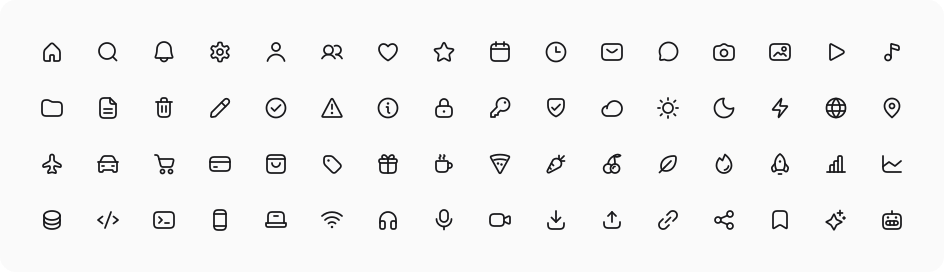

<p align="center">
  <picture>
    <source media="(prefers-color-scheme: dark)" srcset=".github/assets/preview-dark.svg">
    
  </picture>
</p>

<h1 align="center">Koala Icons</h1>

<p align="center">
  506 free, open source icons for React. One 24 px grid, one 1.75 stroke, one spec.
  <br>
  <a href="https://www.koalaui.com/docs/foundations/icons">Browse the icons</a> · <a href="https://www.npmjs.com/package/koala-icons">npm</a> · <a href="./SPEC.md">Drawing spec</a>
</p>

<p align="center">
  <a href="https://www.npmjs.com/package/koala-icons"></a>
  <a href="./LICENSE"></a>
  
</p>

Koala Icons are the icon set of [Koala UI](https://www.koalaui.com). Every glyph is drawn by hand on the same grid,
with the same soft corners and the same weight, so a page full of them reads as one hand. They are
free for personal and commercial work, no attribution required.

## Install

```bash
npm install koala-icons
```

## Usage

```tsx
import { ArrowRight, Info } from "koala-icons"

<button>
  Continue <ArrowRight />
</button>
```

Each icon is also its own module, for setups that do not tree-shake a barrel:

```tsx
import { ArrowRight } from "koala-icons/icons/arrow-right"
```

No hooks and no context: every icon renders in React Server Components as-is.

## Size, colour and weight

Icons default to `1em`, so they follow the font size of the text beside them. Set a size with a
class or the `size` prop (a number is pixels). They draw in `currentColor`, so text colour
utilities colour them.

```tsx
<Info className="size-5 text-zinc-500" />
<Info size={20} color="tomato" />
<Heart weight="fill" />
```

Small sizes get their own masters. Import the optional stylesheet once and icons at 16 px or less
switch to a heavier stroke drawn for that size:

```tsx
import "koala-icons/optical.css"
```

## Accessibility

An icon is decorative by default (`aria-hidden`), because the text next to it already says what
it means. When it stands alone, name it with `title` or `aria-label` and it becomes
`role="img"`.

```tsx
<Info title="More information" />
```

## Coming from Phosphor

Where [Phosphor](https://phosphoricons.com) has the same object, the name matches, and the
`weight` prop accepts Phosphor's values, so moving over is mostly an import-path change.
`koala-icons/meta` exports `ICONS` (name, component, category, tags) for pickers and search.

## Categories

| Category | Icons |
| --- | ---: |
| Interface | 56 |
| Arrows | 56 |
| Status | 54 |
| Files | 52 |
| Business | 43 |
| Editor | 42 |
| Places | 40 |
| Devices | 25 |
| Food | 22 |
| Communication | 18 |
| Media | 18 |
| Commerce | 16 |
| People | 13 |
| Actions | 12 |
| Nature | 11 |
| Weather | 8 |
| Health | 7 |
| Time | 4 |
| System | 2 |
| Tools | 2 |
| Objects | 2 |
| Navigation | 1 |
| Security | 1 |
| Layout | 1 |

## Raw SVG

The masters live in [`svg/`](./svg) (24 px) and [`svg-sm/`](./svg-sm) (small sizes). They are
plain stroked SVG in `currentColor`, ready for Figma, Sketch or any framework.

## Contributing

Requests for missing icons are welcome. Read [CONTRIBUTING.md](./CONTRIBUTING.md) and the
[drawing spec](./SPEC.md) before you draw one.

## License

[MIT](./LICENSE). Free for personal and commercial use.
